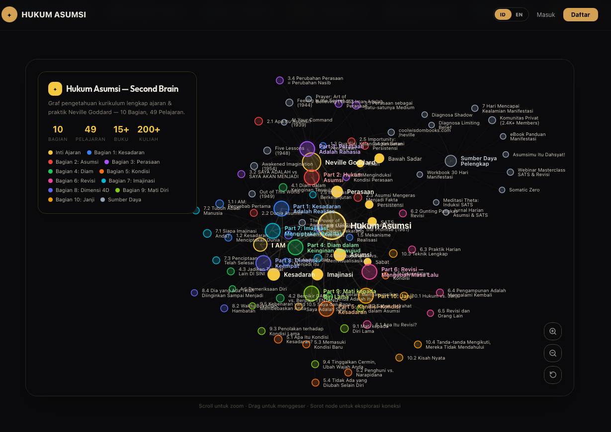
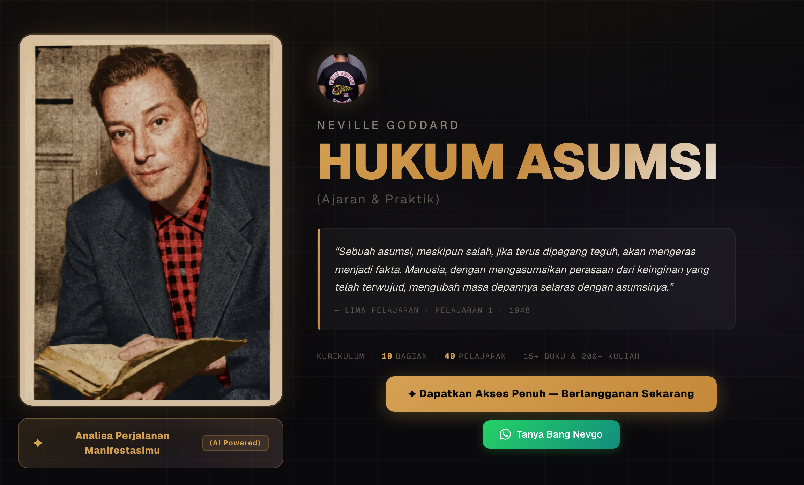
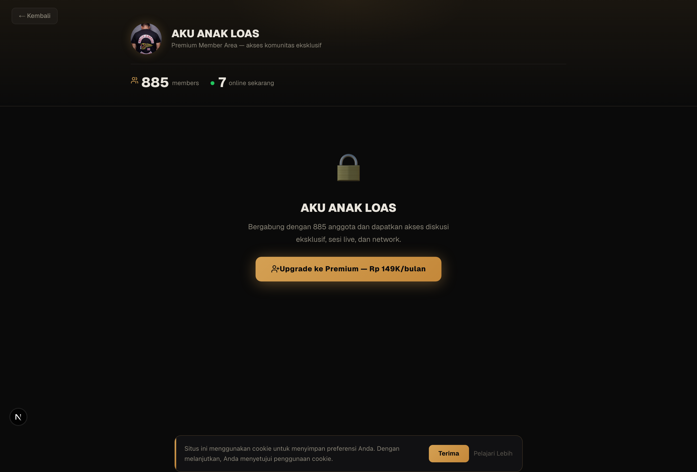
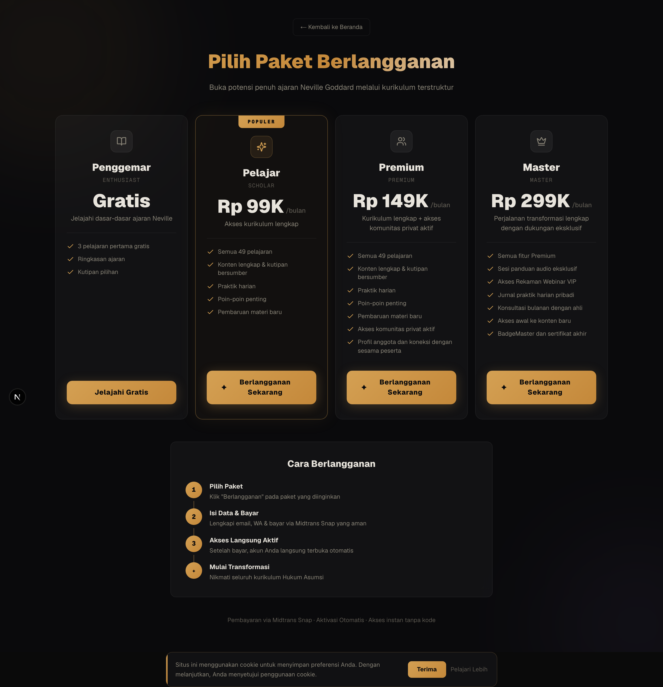

# WEBLOASKECIL — Nevgo Institute (Hukum Asumsi)

<p align="center">
  <a href="https://loas.nevgoinstitute.com">
    
  </a>
</p>

<p align="center">
  <a href="https://loas.nevgoinstitute.com"></a>
  
  
  
  
</p>

> **Platform pembelajaran digital berbasis AI untuk kurikulum Hukum Asumsi (*Law of Assumption*) Neville Goddard oleh [Nevgo Institute](https://loas.nevgoinstitute.com).** Menyediakan kurikulum terstruktur 10 Bagian (50 Pelajaran bilingual ID/EN), **Second Brain Knowledge Graph** interaktif, **5 modul AI Coaching & Diagnostik**, dan ekosistem komunitas pembelajar.

<p align="center">
  
  
</p>
<p align="center">
  
  
</p>

---

## ✦ Arsitektur AI & Fitur Utama (`/api/ai`)

Platform ini mengoperasikan **5 fitur AI bilingual (Indonesia & Inggris)** melalui endpoint produksi [`src/app/api/ai/route.ts`](src/app/api/ai/route.ts), [`src/lib/ai-prompts.ts`](src/lib/ai-prompts.ts), dan abstraksi multi-provider [`src/lib/ai-providers.ts`](src/lib/ai-providers.ts):

1. **AI Manifestation Analyzer (`manifestation`)** — *Free Tier / Lead Magnet*: Menganalisis target manifestasi pengguna di 6 kategori kehidupan dan menghasilkan output JSON terstruktur berisi identifikasi *handicaps*, 5 afirmasi spesifik, durasi latihan, dan langkah ritual harian.
2. **AI Limiting Belief Diagnostic (`limiting-belief`)** — Menganalisis 8 dimensi kuesioner skala & esai untuk memetakan keyakinan penghambat, akar ketakutan (*root fear*), teknik *reprogramming* (SATS/Revisi/I AM), dan estimasi *timeline* transformasi dalam format JSON.
3. **AI Shadow Work Diagnostic (`shadow`)** — Mengolah 8 kuesioner psikologis untuk mengidentifikasi pola bayangan (*shadow patterns*), kaitannya dengan hambatan manifestasi, langkah integrasi, dan latihan harian.
4. **AI Private Consultation Session (`private-session`)** — Sesi konsultasi interaktif *multi-turn chat* 1-on-1 untuk mendiagnosis *bottleneck* mental pengguna secara personal.
5. **Nevi AI 24/7 Companion (`nevi-coach`)** — Asisten belajar 24/7 yang mendampingi murid dalam mempraktikkan kurikulum *Asumsimu Itu Dahsyat*.

---

## 🗄️ Infrastruktur Data, SEO & Telemetry Produksi

- **Kurikulum Terstruktur (SSR & Bilingual):** 10 Bagian & 50 Pelajaran lengkap ([`src/lib/curriculum-data.ts`](src/lib/curriculum-data.ts) & [`src/lib/curriculum-data-en.ts`](src/lib/curriculum-data-en.ts)), dilengkapi *Second Brain Knowledge Graph* ([`src/components/curriculum-graph-view.tsx`](src/components/curriculum-graph-view.tsx)) dan modul audio interaktif ([`src/lib/audio-data.ts`](src/lib/audio-data.ts)).
- **Neon Serverless PostgreSQL & Prisma ORM:** Menyimpan data pengguna (`User`), atribusi prospek multi-channel (`Lead` — terintegrasi via [`/api/leads/stats`](src/app/api/leads/stats/route.ts)), progres belajar (`Completion`), penjadwalan konsultasi (`Booking`), dan kode aktivasi (`ActivationCode`) di [`prisma/schema.prisma`](prisma/schema.prisma).
- **Technical SEO & GEO (AI Search Ready):**
  - Dynamic [`sitemap.ts`](src/app/sitemap.ts) & [`robots.ts`](src/app/robots.ts) untuk 17 rute kanonik SSR/SSG.
  - Rich Structured Data (JSON-LD `Course`, `CourseInstance`, `Offer`, dan `FAQPage`) di [`src/app/layout.tsx`](src/app/layout.tsx) & [`src/app/belajar/[slug]/page.tsx`](src/app/belajar/%5Bslug%5D/page.tsx).
  - [`public/llms.txt`](public/llms.txt) untuk pengindeksan mesin pencari berbasis LLM/AI.
- **Analytics & Web Vitals:** Terintegrasi dengan **Google Analytics 4 Data API (`v1beta`)** di [`src/app/api/analytics/ga4/route.ts`](src/app/api/analytics/ga4/route.ts), **Google Search Console API** di [`src/app/api/analytics/gsc/route.ts`](src/app/api/analytics/gsc/route.ts), **Vercel Analytics**, dan **Vercel Speed Insights**.
- **Omnichannel Webhook & Booking:** Integrasi pembayaran **Midtrans Snap API**, webhook transaksi **Lynk.id** ([`src/app/api/lead/lynk-webhook/route.ts`](src/app/api/lead/lynk-webhook/route.ts)), sinkronisasi otomatis ke **Google Calendar & Meet** ([`src/lib/google-calendar.ts`](src/lib/google-calendar.ts)), **Google Sheets**, dan notifikasi real-time **Telegram Bot**.

---

## 🛠️ Tech Stack

| Layer | Teknologi |
|---|---|
| **Framework** | Next.js 16.1 (App Router, SSR/SSG, Standalone Output) |
| **Language & UI** | TypeScript 5, React 19, Tailwind CSS v4, Radix UI (`shadcn/ui`), Framer Motion |
| **State & Data Fetching** | Zustand 5, TanStack React Query v5 |
| **Database & ORM** | Neon Serverless PostgreSQL + Prisma ORM 6.11 |
| **AI & LLM Layer** | Multi-provider abstraction (`z-ai-web-dev-sdk`, OpenRouter, OpenAI, Anthropic) |
| **Analytics & SEO** | GA4 Data API (`googleapis`), GSC API, `@vercel/analytics`, `@vercel/speed-insights` |
| **Integrations** | Midtrans Client, NextAuth.js, Google Calendar API, Telegram Bot API |

---

## 🚀 Menjalankan Proyek Secara Lokal

### Prasyarat
- Bun (atau Node.js >= 18)
- PostgreSQL (Neon / lokal)

### Instalasi

```bash
# 1. Clone repository
git clone https://github.com/bangnevgo/WEBLOASKECIL.git
cd WEBLOASKECIL

# 2. Install dependencies
bun install

# 3. Konfigurasi environment variables (.env)
cp .env.example .env

# 4. Sinkronisasi skema Prisma ke PostgreSQL
bun run db:push
bun run db:generate

# 5. Jalankan development server
bun run dev
```

Buka [http://localhost:3000](http://localhost:3000).

### Environment Variables Utama

| Variable | Deskripsi |
|---|---|
| `DATABASE_URL` | Connection string PostgreSQL (Neon) |
| `ZAI_API_KEY` / `OPENROUTER_API_KEY` | API key untuk layanan inferensi AI (`/api/ai`) |
| `OPENAI_API_KEY` / `ANTHROPIC_API_KEY` | Opsional — API key provider AI langsung (`src/lib/ai-providers.ts`) |
| `NEXT_PUBLIC_GA_ID` | Google Analytics 4 Measurement ID (`G-C8N91XC6NL`) |
| `GA4_SERVICE_ACCOUNT_*` | Kredensial Service Account untuk GA4 Data API (`/api/analytics/ga4`) |
| `GSC_CLIENT_ID` / `GSC_REFRESH_TOKEN` | Kredensial OAuth2 untuk Google Search Console API (`/api/analytics/gsc`) |
| `MIDTRANS_SERVER_KEY` / `NEXT_PUBLIC_MIDTRANS_CLIENT_KEY` | Kredensial pembayaran Midtrans Snap |
| `TELEGRAM_BOT_TOKEN` / `GOOGLE_SHEET_URL` | Pipeline notifikasi & sinkronisasi lead otomatis |

---

## 📁 Struktur Proyek

```text
├── prisma/
│   └── schema.prisma            # Skema PostgreSQL (User, Lead, Completion, Booking, ActivationCode)
├── public/
│   ├── llms.txt                 # Indeks terstruktur untuk AI/LLM Search Engines (GEO)
│   ├── manifest.json            # Konfigurasi PWA
│   └── screenshots/             # Dokumentasi visual antarmuka aplikasi
├── scripts/                     # Utilitas automasi & migrasi tier kursus
├── src/
│   ├── app/
│   │   ├── api/
│   │   │   ├── ai/              # Endpoint inferensi 5 fitur AI (bilingual ID/EN)
│   │   │   ├── access/          # Manajemen hak akses & pemulihan akun member
│   │   │   ├── analytics/       # Integrasi server-side GA4 & Google Search Console
│   │   │   ├── auth/            # Autentikasi pengguna & sesi
│   │   │   ├── booking/         # Penjadwalan sesi konsultasi & Google Calendar/Meet
│   │   │   └── lead/ & leads/   # Registrasi lead, deduplikasi, webhook Lynk.id & statistik
│   │   ├── artikel/             # Rute SSR artikel SEO
│   │   ├── audio/               # Rute SSR audio pembelajaran
│   │   ├── belajar/[slug]/      # Rute SSG/SSR 10 bagian kurikulum (50 pelajaran) + JSON-LD
│   │   ├── community/           # Portal komunitas eksklusif
│   │   ├── sitemap.ts           # Generator sitemap.xml dinamis
│   │   └── robots.ts            # Generator robots.txt dinamis
│   ├── components/              # Komponen UI interaktif (AI Hub, Knowledge Graph, Dashboard)
│   └── lib/                     # Data kurikulum, prompt AI (520+ baris), Prisma client, store
└── tests/                       # Pengujian otomatis routing & pemulihan akses
```

---

## 📄 Lisensi

Hak cipta © **Nevgo Institute (Bang Nevgo)**. Seluruh hak cipta dilindungi.
